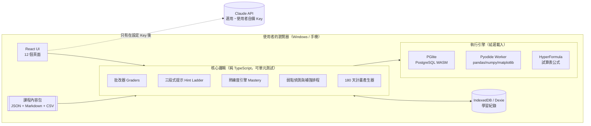

# 01 技術選型與系統架構

## 1. 選型原則

1. **零月費**：使用者是一個人在轉職，平台不能變成另一筆固定支出。
2. **練習必須是「真的執行」**：SQL 要真的跑查詢、Python 要真的跑 Pandas，不能只比對字串。
3. **紀錄不能遺失**：重新整理、關閉瀏覽器、重開機都要保留進度，而且要能備份。
4. **維護成本低**：課程與題目是「資料檔」，新增內容不必改程式。
5. **誠實**：平台做不到的事（例如自動批改 .pbix 檔）就明說，改用其他可驗證的方式。

## 2. 技術方案總表

| 層 | 選擇 | 為什麼 | 放棄的替代方案 |
|---|---|---|---|
| 框架 | **Vite + React 18 + TypeScript** | 生態最大、型別安全，題目／課程資料結構複雜，需要型別保護 | Next.js（不需要 SSR，徒增部署複雜度） |
| 樣式 | **Tailwind CSS** + CSS 變數主題 | 深淺色切換只需換變數；RWD 寫法一致 | 元件庫整套（客製 SaaS 風格反而受限） |
| 路由 | **React Router（HashRouter）** | 靜態主機不用設定 rewrite，重新整理不會 404 | BrowserRouter（需主機設定） |
| 圖表 | **Recharts** | 雷達圖、折線、長條一套搞定，React 友善 | ECharts（較重） |
| 程式編輯器 | **CodeMirror 6** | 輕量、支援 SQL/Python 語法高亮與自動完成、手機可用 | Monaco（2MB+、手機體驗差） |
| SQL 引擎 | **PGlite（瀏覽器內 PostgreSQL，WASM）** | 真正的 PostgreSQL 語法：`DATE_TRUNC`、`INTERVAL`、Window Functions、CTE 全部支援，與企業常見的 PostgreSQL / BigQuery / Redshift 寫法接近 | sql.js（SQLite 的日期處理與企業 SQL 差太多，會教出錯的習慣） |
| Python 引擎 | **Pyodide（WASM）+ pandas / numpy / matplotlib**，跑在 Web Worker | 真的執行 Pandas，畫面不會卡住；圖表輸出成圖片顯示 | 後端沙箱（要錢、要維運） |
| 試算表公式 | **HyperFormula** 公式引擎 | 在網頁內驗算 `VLOOKUP`/`XLOOKUP`/`SUMIFS`/`COUNTIFS` 等公式，與 Google 試算表／LibreOffice 相容 | 只比對答案數字（無法給「錯在哪」的提示） |
| 本機資料庫 | **IndexedDB + Dexie.js** | 容量大（可存截圖、報告附件）、支援交易與版本遷移；`navigator.storage.persist()` 降低被瀏覽器清除的機率 | localStorage（5MB、無結構） |
| 備份 | JSON 匯出／匯入（含附件 base64） | 換電腦、換瀏覽器都能帶走 | — |
| 跨裝置雲端同步（選用，已上線） | Supabase 免費方案（PostgreSQL + 帳號登入 + 列層級安全性） | 手機、平板、電腦共用同一份紀錄；離線照常使用，恢復網路自動同步。設定見 [07-cloud-sync.md](07-cloud-sync.md) | Firebase（非開源、資料模型較不適合） |
| AI 導師（選用） | Anthropic Claude API，使用者自備 Key | 見 [05-ai-tutor.md](05-ai-tutor.md) | 平台代付（會產生費用與金鑰外洩風險） |
| 測試 | **Vitest**（邏輯）＋ **Playwright**（端對端，每個按鈕都要點到） | 第 7 階段的驗收工具 | — |
| 部署 | **GitHub Pages** 或 Cloudflare Pages（免費） | push 即部署 | — |

### 關於 Power BI 與 Excel 的現實限制

- **Power BI Desktop 是免費的**，使用者用 Windows，可以直接安裝。網頁無法在瀏覽器裡執行 Power BI，也無法可靠地自動批改 `.pbix`。
  平台的做法：
  1. 提供下載用資料集與逐步任務；
  2. **DAX 練習在平台內可驗證**：題目給定資料模型，使用者寫出量值，平台以「同一份資料用 SQL/Python 算出的正確數字」比對使用者在 Power BI 算出並回填的結果，並對 DAX 文字做模式檢查（例如是否用了 `CALCULATE` + `DATESYTD`）；
  3. 儀表板以「主管評分表」＋截圖上傳評估；有 AI Key 時可讓 AI 看截圖給建議，但**最後分數以評分表為準，不假裝自動判讀 .pbix**。
- **Excel 替代**：主用 Google 試算表（免費、雲端、與 Excel 公式最接近），LibreOffice Calc 為離線備案。平台內的公式題用 HyperFormula 實際計算。課程中會標註 Excel 與 Google 試算表的差異（例如 `QUERY()` 只有 Google 有、樞紐分析表介面不同），避免面試時講錯。

## 3. 系統架構



### 兩種資料要分開

| 類型 | 存放 | 例子 | 可變性 |
|---|---|---|---|
| **內容（Content）** | Git 倉庫的 `content/` 目錄，建置時打包 | 課程、題目、資料集、產業情境、評分表、面試題 | 唯讀，隨版本更新 |
| **使用者資料（User Data）** | 瀏覽器 IndexedDB | 作答紀錄、熟練度、錯題、專案提交、計畫 | 讀寫，需備份 |

這樣做的好處：更新課程不會動到使用者的紀錄；使用者資料只存「內容 ID」，內容改版時用 `contentVersion` 做相容。

## 4. 練習題的批改方式（不能只比字串）

| 題型 | 批改方式 |
|---|---|
| SQL | 在 PGlite 執行使用者查詢與標準答案查詢，比對結果集：欄位數、欄位名稱（可設定是否要求別名）、列數、內容（無 `ORDER BY` 要求時不比順序、數值容差 0.01）。另可設定「必須使用」的語法（例如此題必須用 Window Function）。 |
| Python | 在 Pyodide 執行使用者程式碼，接著執行隱藏的檢查程式（assert DataFrame 形狀、欄位、數值、是否處理缺失值），並保留 stdout 與錯誤訊息。 |
| 試算表公式 | HyperFormula 在題目資料表上計算使用者公式，與標準值比對。 |
| DAX | 回填數值比對 ＋ DAX 文字模式檢查（見上）。 |
| 單選／多選／填空 | 直接比對；多選採部分給分（答錯扣分，避免全選）。 |
| 資料分析題 | 數值答案 + 容差，或結構化選項（例如「營收下降主因來自哪個通路」）。 |
| 商業情境題／報告 | 結構化部分自動批改；文字部分用評分表（自評 + 參考答案對照，或 AI 依評分表評估，見 05）。 |

**錯在哪的自動判斷（三段式提示的第一段）**：SQL 批改器會輸出可讀診斷，例如「你的結果有 120 列，正確答案是 12 列 → 可能少了 GROUP BY 或 JOIN 造成重複」「欄位 `revenue` 數值偏大約 3 倍 → 檢查 JOIN 是否放大了列數」。這些規則不需要 AI，完全本機運作。

## 5. 專案目錄規劃

```
project/
├─ content/                      # 課程內容（資料，不是程式）
│  ├─ curriculum.json            # 6 階段 → 週 → 單元 的結構與天數
│  ├─ concepts.json              # 概念標籤（sql.join.left、py.pandas.groupby…）
│  ├─ lessons/<moduleId>/<lessonId>.md
│  ├─ questions/<bank>.json      # 題庫（依概念標籤索引）
│  ├─ datasets/<datasetId>/      # CSV + schema.json + 產生器 seed
│  ├─ scenarios/<industry>/<id>.json   # 產業模擬（主管任務）
│  ├─ rubrics/*.json             # 評分表
│  └─ interview/*.json           # 面試題
├─ scripts/
│  ├─ generate-datasets.ts       # 以固定 seed 產生「埋有答案」的模擬資料
│  └─ validate-content.ts        # 檢查每題標準答案能跑、提示齊全、概念標籤存在
├─ src/
│  ├─ app/                       # 路由、版面（左側導覽、主題切換）
│  ├─ pages/                     # 12 個主要頁面
│  ├─ components/                # 共用 UI（進度條、雷達圖、CodeEditor…）
│  ├─ engines/                   # pglite.ts、pyodide.worker.ts、formula.ts
│  ├─ core/                      # graders/、hints/、mastery/、remediation/、planner/、scoring/
│  ├─ db/                        # Dexie schema、migrations、backup
│  ├─ ai/                        # AI 導師（選用）：client、prompts、cost meter
│  └─ types/                     # 內容與使用者資料型別
├─ tests/                        # vitest 單元測試 + playwright e2e
└─ docs/
```

## 6. 模擬資料集策略（訓練品質的關鍵）

真實工作中，分析的價值在於「找到原因」。如果資料是亂數，題目就沒有正確的商業答案。因此：

- 所有資料集由 `scripts/generate-datasets.ts` 以**固定亂數種子**產生，每次結果相同，答案可驗證。
- 每份資料集**刻意埋入故事與髒資料**，例如：
  - 電商：本月營收 −15%，其中 70% 來自「行動 App 新客轉換率下降」，另有一檔促銷結束造成客單價下滑；資料中混有重複訂單、退款負數、時區錯誤。
  - 製造：B 產線第 3 台設備在夜班良率異常，伴隨溫度感測值飄移。
- 埋入的「真相」寫在情境檔的 `groundTruth`，供批改與主管回饋使用，使用者看不到。
- 規模控制在瀏覽器可順跑的範圍（主資料表 5 萬列以內），同時提供 CSV 讓使用者用 Power BI / Google 試算表開啟。

## 7. 效能與相容性

- PGlite（約 3MB）與 Pyodide（含 pandas 約 15–25MB）**只在進入練習室時才載入**，首次下載後由瀏覽器快取；首頁保持輕量。
- Pyodide 跑在 Web Worker，長時間程式可「中止執行」；預設 10 秒逾時保護。
- 目標瀏覽器：Windows 上的 Chrome / Edge 最新版；手機可瀏覽課程、做選擇題與看儀表板，程式練習建議用電腦。
